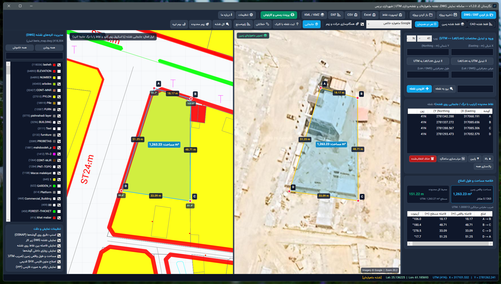
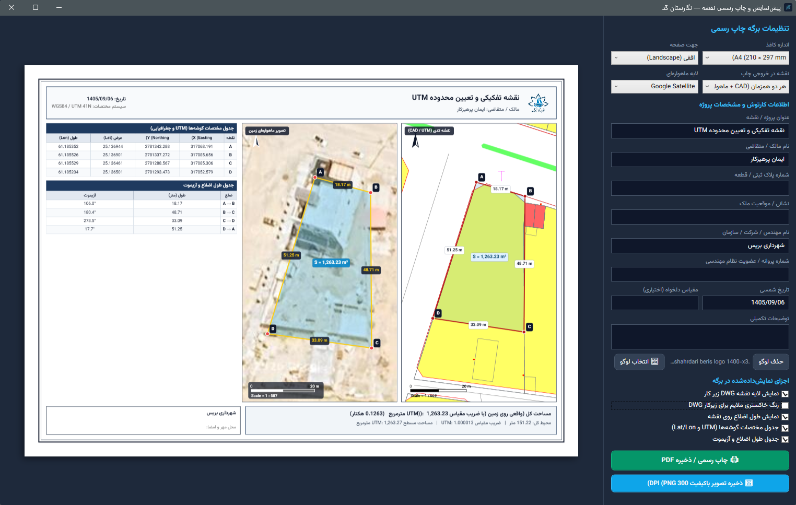

<div dir="rtl">

# نگارستان کَد (NegarestanCAD) — نسخه 1.2.0

**سامانه حرفه‌ای ویندوزی نمایش نقشه‌های DWG / DXF، تصاویر ماهواره‌ای زمین، تبدیل مختصات UTM و چاپ رسمی مهندسی**

توسعه یافته توسط **شهرداری بریس** — **ایمان پرهیزکار** (سال 1405)

[-0EA5E9)](https://dotnet.microsoft.com/)
[](LICENSE)
[](#)

---




## ویژگی‌های جدید نسخه 1.2.0

- **نقشه ماهواره‌ای بومی با همگام‌سازی زنده دوطرفه (CAD ↔ زمین):**
  - پشتیبانی از ۴ منبع رایگان و باکیفیت: **Google Hybrid (ماهواره + برچسب فارسی)**، **Google Satellite**، **Esri World Imagery** و **OpenStreetMap** بدون نیاز به کلید API یا WebView2
  - **کش هوشمند حافظه و دیسک** برای نمایش سریع و استفاده مجدد بدون دانلود تکراری
  - **سه حالت نمایش قابل کنترل:** ۱) فقط نقشه CAD، ۲) فقط نقشه ماهواره‌ای زمین، ۳) هر دو همزمان با **اسپلیتر قابل تغییر عرض**
  - **همگام‌سازی دوطرفه لحظه‌ای Pan و Zoom:** حرکت یا زوم روی هر نقشه، نقشه مقابل را دقیقاً در همان مختصات و مقیاس جابجا می‌کند
  - امکان کار کامل با نقشه ماهواره‌ای (ثبت نقطه با کلیک، درگ نقاط، خط‌کش، زاویه‌سنج و چاپ رسمی) **حتی بدون باز کردن فایل DWG** (با موقعیت شروع پیش‌فرض بریس `25.135843, 61.188676`)
- **چاپ رسمی دوگانه (CAD + ماهواره):**
  - امکان انتخاب خروجی چاپ در ۳ حالت: **هر دو نقشه کنار هم (CAD + ماهواره)**، **فقط CAD** یا **فقط ماهواره** با کیفیت برداری و خروجی 300 DPI PNG
- **پنجره تنظیمات پایدار برنامه (`⚙️ تنظیمات`):**
  - ذخیره دائمی نام پیش‌فرض سازمان/شرکت، شماره پروانه، **لوگوی پیش‌فرض برای تمام پرینت‌ها**، حالت بوم تیره/روشن، **فایل DWG پیش‌فرض هنگام باز شدن برنامه**، مختصات شروع ماهواره، منبع نقشه و مدیریت کش تصاویر
- **بهینه‌سازی سرعت و تجربه کاربری:**
  - بارگذاری غیرمسدودکننده (Async) فایل‌های DWG سنگین (+۴۰۰ هزار المان) با نشانگر پیشرفت
  - دکمه **«برو به نقطه»** برای پرش مستقیم هر دو نقشه به مختصات واردشده + میانبرهای صفحه‌کلید (`Ctrl+O`، `Ctrl+S`، `Ctrl+P`، `Esc`)
  - **ورود سریع نقطه با کیبورد (`+`):** با زدن کلید `+`، تایپ `X, Y` (یا `Lat, Lon`) و زدن `Enter` نقاط `A, B, C...` بلافاصله روی هر دو نقشه ثبت می‌شوند، همراه با دکمه **«برو به نقطه»** و میانبرهای `Ctrl+O`، `Ctrl+S`، `Ctrl+P` و `Esc`
  
---

## امکانات کامل سامانه

- **نمایش DWG و DXF بدون نیاز به AutoCAD:** رندر ۶۰ فریم با کش تصویری، پشتیبانی از `Line`، `LwPolyline` (با Bulge و عرض واقعی `ConstantWidth`)، `Polyline2D/3D`، `Circle`، `Arc`، `Ellipse`، `Spline`، `Solid`، `Hatch` (تُپُر با ماسک `EvenOdd` و الگودار)، `Text/MText` (اصلاح متون فارسی قدیمی SHX)، بلوک‌های تودرتو (`Insert`)، مدیریت لایه‌ها و **OSNAP زنده**.
- **تبدیل دقیق دوطرفه UTM ↔ Lat/Lon (WGS84):** تمام ۶۰ زون (پیش‌فرض **41N**)، ورودی اعشاری و DMS، جابجایی نقاط روی هر دو نقشه با درگ، تغییر ترتیب در لیست با Drag & Drop، مرتب‌سازی ساعتگرد و محاسبه **مساحت واقعی روی زمین (ضریب مقیاس UTM)** و مساحت مسطح.
- **ذخیره پروژه و خروجی/ورودی چندفرمته:** `.cadproj`، **Excel (`.xlsx`)**، **CSV / TXT**، **DXF** و **KML / KMZ** (Google Earth).
- **پرینت رسمی مهندسی:** A4/A3 افقی و عمودی، کارتوش کامل با تاریخ شمسی و لوگو، فلش شمال، خط‌کش مقیاس گرافیکی، جداول کامل مختصات و اضلاع و کادر مهر و امضا.

---

## نصب و اجرا

### ۱. دانلود نسخه آماده
از بخش **Releases** فایل فشرده `NegarestanCAD-v1.2.0-win-x64.zip` را دانلود، استخراج و `NegarestanCAD.exe` را اجرا کنید.

### ۲. بیلد از سورس‌کد
پیش‌نیاز: [.NET 8 SDK](https://dotnet.microsoft.com/download/dotnet/8.0) یا Visual Studio 2022

```bat
git clone https://github.com/imanpr/NegarestanCAD.git
cd NegarestanCAD
build.bat
```
فایل اجرایی مستقل در مسیر `publish\win-x64\NegarestanCAD.exe` ساخته می‌شود.

---

## کتابخانه‌های متن‌باز

- [ACadSharp 3.8.35](https://www.nuget.org/packages/ACadSharp) — خواندن و نوشتن فایل‌های DWG و DXF
- [ClosedXML 0.105.1](https://www.nuget.org/packages/closedxml/) — خروجی و ورودی فایل‌های Excel (`.xlsx`)
- [Vazirmatn](https://github.com/rastikerdar/vazirmatn) — فونت فارسی رابط کاربری و چاپ

---

## درباره سازنده

- **سازمان:** شهرداری بریس — [www.beris.ir](https://www.beris.ir)
- **طراحی و توسعه:** ایمان پرهیزکار — [imanic.ir](https://imanic.ir)
- **سال انتشار:** 1405

</div>
